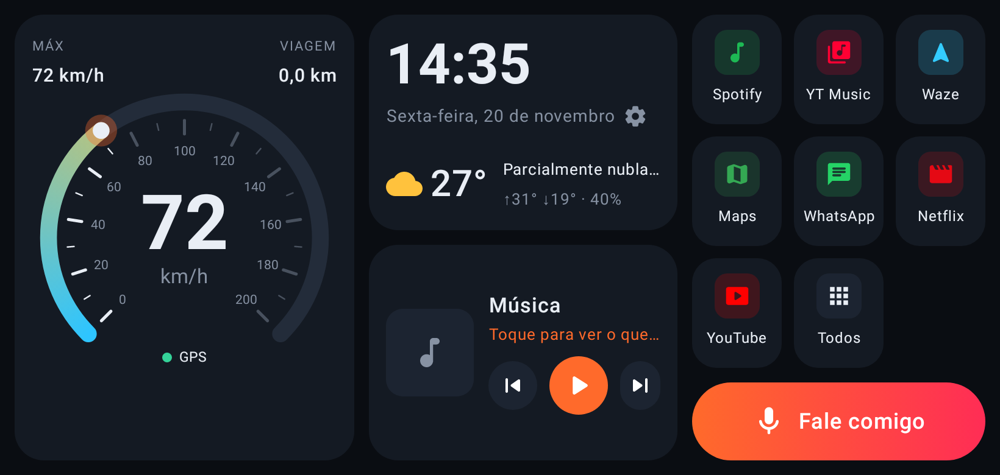
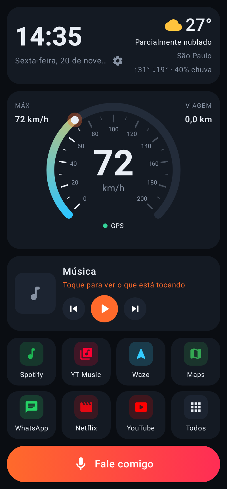
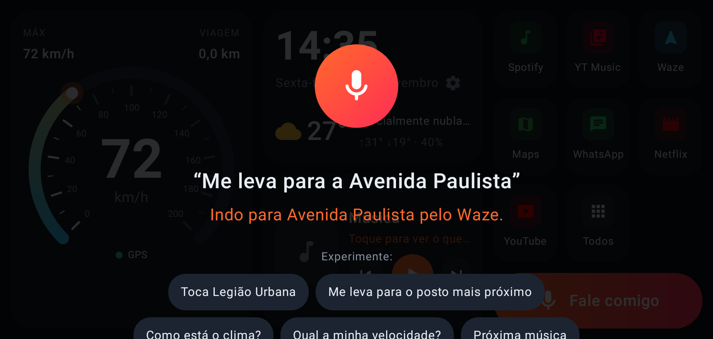

# Punto OS — launcher de carro para Android

Tela inicial (launcher) leve e escura para usar no carro: velocímetro, clima,
música, atalhos dos apps e um assistente de voz em português.

Serve tanto para o **celular** quanto, depois, para a **central multimídia Android**
do carro (é o mesmo Android).

| Paisagem | Retrato |
|---|---|
|  |  |



## O que já faz

- **Velocímetro** pelo GPS do celular (0–200 km/h), velocidade máxima e km da viagem
  (toque em "VIAGEM" para zerar).
- **Relógio, data e clima** da sua cidade (API gratuita Open-Meteo, sem chave).
- **Música**: mostra o que está tocando (capa, nome, artista) e tem botões
  anterior / play-pausa / próxima. Funciona com Spotify, YouTube Music, etc.
- **Atalhos**: Spotify, YouTube Music, Waze, Maps, WhatsApp, Netflix, YouTube e a
  gaveta "Todos" com busca. Se o app não estiver instalado, abre a Play Store.
- **Segurança**: Netflix, YouTube e outros apps de vídeo não abrem com o carro acima de 10 km/h.
- **Assistente de voz** (botão "Fale comigo"):

| Você fala | O que acontece |
|---|---|
| "Toca Legião Urbana" / "toca Anitta no YouTube Music" | Começa a tocar no Spotify ou YouTube Music |
| "Pausa", "próxima", "música anterior", "aumenta o volume" | Controla a música |
| "Me leva para a Avenida Paulista, 1000" / "me leva pra casa" | Abre o Waze (ou Maps) navegando |
| "Como está o clima?" / "vai chover?" | Fala temperatura, máx/mín e chance de chuva |
| "Que horas são?" / "qual a minha velocidade?" / "quantos km eu andei?" | Responde em voz |
| "Manda um zap pra Ana dizendo que estou chegando" | Abre o WhatsApp na conversa com a mensagem pronta (você só toca em enviar) |
| "Liga para o Pedro" | Abre o discador com o número |
| "Abre a Netflix" | Abre qualquer app instalado pelo nome |

## Como instalar no celular

1. Baixe o arquivo `punto-os.apk` no celular.
2. Abra o arquivo. O Android vai pedir para **permitir instalar apps desta fonte**: permita.
3. Abra o **Punto OS** e aceite as permissões de **localização** (velocímetro e clima)
   e **microfone** (assistente).
4. Na engrenagem ⚙️ (ao lado da data):
   - **Usar o Punto OS como tela inicial**: escolha "Punto OS" como app de tela inicial.
     Para voltar ao normal, escolha o launcher antigo no mesmo lugar.
   - **Permitir mostrar a música tocando**: ative o "Punto OS" na lista.
   - Cadastre o **endereço de casa e do trabalho** e escolha Spotify/YouTube Music e Waze/Maps.

> Dá para testar sem trocar a tela inicial: é só abrir o Punto OS como um app comum.

## Compilar

Precisa do JDK 17+ e do Android SDK (platform 35):

```bash
./gradlew assembleRelease        # APK em app/build/outputs/apk/release/
./gradlew testDebugUnitTest      # testes do assistente + screenshots em app/build/screenshots/
```

Estrutura:

```
app/src/main/java/com/punto/launcher/
  MainActivity.kt          # permissões, GPS, clima, liga tudo
  assistant/CommandParser  # entende a frase (pt-BR, sem acento, regras)
  assistant/Assistant      # executa: Spotify, Waze, WhatsApp, clima...
  assistant/Voice          # microfone (fala->texto) e voz (texto->fala)
  data/                    # GPS/viagem, clima, música, apps, preferências
  ui/                      # tela inicial, velocímetro, gaveta, assistente, configurações
```

## Próximos passos

1. **Dados do carro (OBD2)**: ler temperatura do motor, RPM, tensão da bateria por um
   leitor OBD2 Bluetooth (ex.: Vgate iCar Pro) e mostrar no painel.
2. **IA de verdade**: hoje o assistente entende frases por regras (funciona offline e de graça).
   O próximo passo é mandar o texto para um modelo de IA com "ferramentas"
   (tocar música, navegar, clima...) para entender qualquer jeito de falar.
3. **Palavra de ativação** ("Ok Punto") sem precisar tocar na tela.
4. **Carro em 3D** e informações da rede CAN (portas, combustível), quando estiver na central.
